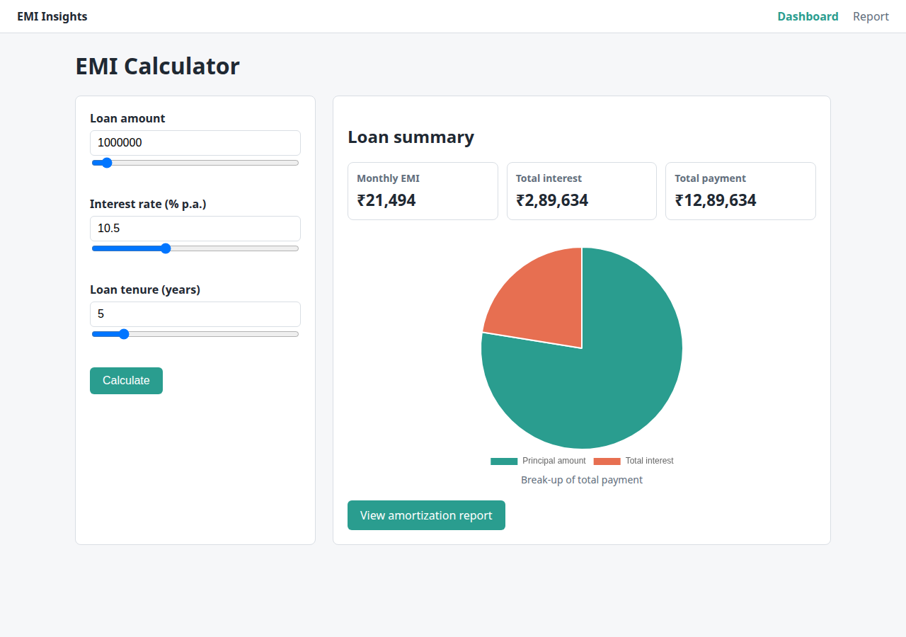
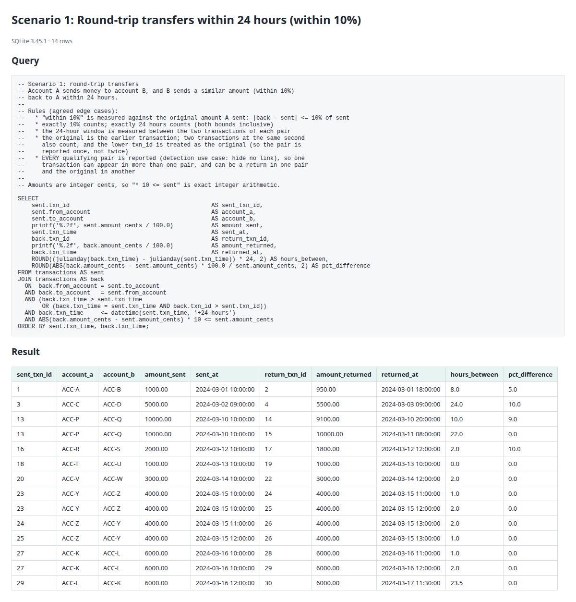
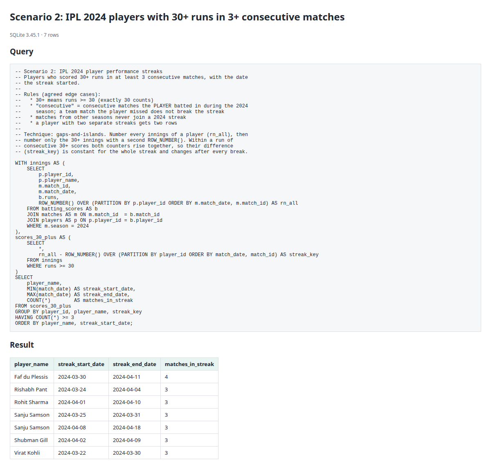

# QA Automation Assignment: Playwright BDD Framework

A **Python Playwright + pytest-bdd (Cucumber/Gherkin)** automation framework covering four
independent tasks:

- **A1–A2:** EMI Insights, a small EMI calculator web app built for this assignment, its UI tests, and API tests for its own backend
- **A3:** API tests for the public JSONPlaceholder service (unrelated to the EMI app)
- **A4:** two SQL scenarios
- **AI:** a self-healing locator exercise

| Section | What | Where |
|---|---|---|
| A1 | Web app: dashboard, report with filters, pie + bar charts | [`app/`](app/) |
| A2 | UI automation (feature / step / page object files, env config), plus API tests for the app's own backend | [`features/`](features/), [`steps/`](steps/), [`pages/`](pages/) |
| A3 | API tests: boundary and invalid data on `POST /posts` | [`features/api_posts.feature`](features/api_posts.feature) |
| A4 | SQL: round-trip transfers, IPL streaks | [`sql/`](sql/) |
| AI | 5 broken locators + self-healing design + working POC | [`docs/SELF_HEALING.md`](docs/SELF_HEALING.md) |
| Results | HTML reports, screenshots, JUnit XML, console log | [`reports/`](reports/), [`sql/screenshots/`](sql/screenshots/) |

> **Cucumber in Python:** Cucumber itself targets JavaScript/Java/Ruby. This project uses
> **pytest-bdd**, the standard Python equivalent: the same Gherkin `.feature` files, with step
> definitions in Python.

---

## Latest results

Full run with `./run_tests.sh` on 2026-10-16: **overall exit code 0**.

| Suite | Result |
|---|---|
| UI: dashboard + report | **47 passed** |
| App API (EMI Insights backend) | **17 passed** |
| API (JSONPlaceholder) | **10 passed** (positive), **14 xfailed** (negative + stress: known API defects, see [API findings](#a3-api-findings)) |
| SQL | **14 passed** |
| Settings unit tests | **3 passed** |
| Self-healing, healer off | **5 xfailed**: expected failures, the locators are broken on purpose |
| Self-healing, healer on | **5 passed**: all 5 healed and validated at runtime |

### Evidence

| Screenshot | Shows |
|---|---|
| [Dashboard](reports/evidence/01-dashboard.png) | Default loan: EMI ₹21,494, cards and pie chart |
| [Validation errors](reports/evidence/02-dashboard-validation-errors.png) | `1000,000`, `35`, `5.0` rejected with the standard messages; no result, report link disabled |
| [Report, yearly](reports/evidence/03-report-yearly.png) | ₹25,00,000 at 9% for 20 years: bar chart, table and totals |
| [Report, monthly](reports/evidence/04-report-monthly-year-2.png) | Monthly view filtered to Year 2 (12 rows, totals add up) |
| [Filter error](reports/evidence/05-report-filter-error.png) | From Year 4 to Year 2 rejected |
| [Test report](reports/evidence/06-test-report.png) | Summary of all 105 main-suite results |
| [Self-healing off](reports/evidence/07-self-healing-off-report.png) / [on](reports/evidence/08-self-healing-on-report.png) | 5 expected failures without the healer, 5 passed with it |
| [SQL scenario 1](sql/screenshots/scenario1_round_trip.png) / [scenario 2](sql/screenshots/scenario2_ipl_streaks.png) | Query and result of each SQL scenario |



Full reports and logs:
- [`reports/test-report.html`](reports/test-report.html): main suite, self-contained, with a final-state screenshot of every UI scenario
- [`reports/self-healing-broken.html`](reports/self-healing-broken.html) / [`reports/self-healing-healed.html`](reports/self-healing-healed.html)
- [`reports/self_healing/healing-report.md`](reports/self_healing/healing-report.md): suggested locator fixes with validation evidence
- [`reports/screenshots/`](reports/screenshots/): one screenshot per UI scenario, named `passed__` / `xfailed__` / `FAILED__`; [`reports/junit.xml`](reports/junit.xml); [`reports/console.log`](reports/console.log): full console output of the run
- [`reports/artifacts-self-healing-broken/`](reports/artifacts-self-healing-broken/): Playwright traces of the 5 intentional failures (`playwright show-trace <trace.zip>`)
- [`sql/results/`](sql/results/) and [`sql/screenshots/`](sql/screenshots/): SQL query outputs

---

## Setup

Requirements: Python 3.10+.

```bash
python3 -m venv .venv
source .venv/bin/activate          # Windows: .venv\Scripts\activate
pip install -r requirements.txt
playwright install chromium
```

## How to run

```bash
./run_tests.sh                      # everything: tests, SQL outputs and evidence screenshots
```

Or run pieces individually:

```bash
pytest                              # main suite: UI + API + SQL (self-healing excluded)
pytest -m ui                        # UI only
pytest -m api                       # API only
pytest -m sql                       # SQL only
pytest -m smoke                     # quick health check
pytest -m self_healing              # broken locators: 5 expected failures (xfail)
SELF_HEAL=true pytest -m self_healing   # healer enabled
ENV=ci pytest                       # use config/.env.ci
HEADLESS=false SLOW_MO_MS=300 pytest -m ui   # watch the browser
python -m sql.sql_runner            # print SQL results, save .txt + .png
python -m app.server                # run the app by hand at http://127.0.0.1:5000
```

The tests start the app automatically (`START_APP=true`) on the port in `BASE_URL`.

---

## Architecture

```
features/*.feature        Gherkin scenarios (what is tested, in business language)
        │
steps/test_*_steps.py     Step definitions: map each Gherkin line to page-object calls
steps/conftest.py         Shared steps + page-object fixtures
        │
pages/*.py                Page Object Model: locators + actions + reads, no assertions
api/posts_client.py       API client on Playwright's APIRequestContext
        │
utils/emi_oracle.py       Independent expected-value calculator (Decimal math; never imports app/)
config/settings.py        Loads config/.env.<ENV>; shell variables override file values
conftest.py               App server, browser settings, report screenshots, known-defect tags
        │
app/                      The application under test (Flask + Chart.js)
```

### Environment configuration

No URL is hard-coded in tests or pages. `ENV` selects `config/.env.<ENV>` (default `local`):

| Variable | Purpose |
|---|---|
| `BASE_URL` | Web app URL (host/port also used to start the app) |
| `API_BASE_URL` | JSONPlaceholder base URL |
| `START_APP` | Start the Flask app for the test session |
| `HEADLESS`, `SLOW_MO_MS` | Browser mode |
| `DEFAULT_TIMEOUT_MS` | Playwright default timeout |
| `SELF_HEAL` | Enable the self-healing POC |
| `REPORTS_DIR` | Where results go |

Any variable set in the shell wins over the file, for example `BASE_URL=http://staging:8080 pytest`.
Secrets (for example an LLM API key) go in `config/.env.secrets`, which is gitignored.

### Locator strategy

Priority: **role + accessible name → label → data-testid → text**. There are no positional CSS
selectors, XPath or generated classes (except the 5 intentionally broken ones).

| Element | Locator |
|---|---|
| Inputs | `get_by_label("Loan amount", exact=True)`. `exact` avoids matching the "Loan amount slider" |
| Buttons / links | `get_by_role("button", name="Calculate")` |
| Charts | `get_by_role("img", name="Principal vs interest chart")` (canvas has `role="img"`) |
| Table rows | `get_by_role("table", name="Amortization schedule")` → `get_by_role("row")` |
| Values with no accessible name | `get_by_test_id("emi-value")` |

The app was built for testability: real `<label>`s, ARIA names, `data-testid` on values, and a
`data-state` attribute so tests wait for results deterministically instead of sleeping.

### How the "expected value" is independent

- `utils/emi_oracle.py` computes EMI and the schedule with `Decimal`, month by month, separately from the app's float math
- Each EMI example also carries a hand-checked value (verify on [emicalculator.net](https://emicalculator.net/)), so there are two independent checks
- Chart checks read the **data the Chart.js instance is drawing**, the rendered bar heights, and painted canvas pixels. They are not just "the canvas is visible"

---

## A2: UI coverage

**Dashboard** ([`dashboard.feature`](features/dashboard.feature)):
- Page loads: title, heading, summary cards, chart
- 7 EMI calculations, including 0% interest and the minimum/maximum loan amounts, checked against the oracle and a hand-checked value
- Accepted amount formats: Indian `10,00,000`, international `1,000,000`, decimals `1000000.00`
- Chart: 2 labelled segments, all values > 0, segments sum to the total payment, canvas actually painted
- 21 invalid inputs: empty, non-numeric, badly grouped commas (`1000,000`), scientific notation, spaces, below/above range, negative, `10,5` rate, `5.0` / `2.5` tenure; each shows a message and no result
- Navigation to the report keeps the loan details; no report link is offered for invalid input

**Report** ([`report.feature`](features/report.feature)):
- One row per year; every row matches the oracle within ₹1
- Principal sums to the loan; final balance is 0; totals row is consistent
- Monthly view (36 rows for 3 years); year filter (3 ranges); invalid range message
- Bar chart: a bar for each year, all values and rendered heights > 0, matches the table
- Monthly rows add up **exactly** to the totals row (a loan that used to be off by ₹35)
- A server failure (502 HTML page) shows *"Something went wrong, please try again"* on the
  dashboard and the report instead of leaving the page blank
- Chart slices equal the summary cards, also for a decimal amount
- **Every UI scenario** is also checked for JavaScript errors, failed requests and HTTP errors
  (a 400 from the app's API is a normal validation answer). Scenarios that trigger server errors on
  purpose are tagged `@allow_http_errors`

**App API** ([`emi_api.feature`](features/emi_api.feature)): tests the app's own backend directly,
because some inputs cannot be sent through the UI (the year filters are dropdowns):
- Valid EMI request; the tab icon is served (headless browsers never request it)
- Invalid year filters (`abc`, `2.5`, `0`, beyond the tenure, From after To) and an unknown view
  are rejected with 400 and a clear message, never a server error; when both years are invalid,
  both messages are returned
- The yearly schedule is sent once (no duplicate yearly list in the response)
- For 5 loans, yearly and monthly rows add up exactly to the totals, each row's payment equals
  principal + interest, the principal total equals the loan and the balance runs down to ₹0

### App behaviour decisions

- **Rounding:** every amount is shown in whole rupees. Rounding each row on its own made the
  rows drift from the totals (by up to ₹35 on a 10-year monthly schedule). The app rounds the
  running total instead and gives each row the difference, so rows always add up exactly; each
  row stays within ₹1 of its exact value. Yearly rows are the sum of their rounded months, so
  the two views always agree. Checked on 336 loans.
- **Summary rounded once, on the server:** EMI, total payment and total interest are returned in
  whole rupees. Total payment uses the exact EMI (₹21,493.90 × 60 = ₹12,89,634; some calculators
  multiply the rounded EMI instead: ₹21,494 × 60 = ₹12,89,640), and total interest = total payment −
  loan amount, so principal + interest always equals the total and the chart matches the cards.
- **Validation messages follow one standard:** `<Field> <rule>`, where `<Field>` is the label shown
  on screen, with no examples and no full stop. Messages are built from these patterns in
  `app/emi.py`, so a new message cannot drift from the standard.

  | Rule | Pattern | Messages |
  |---|---|---|
  | Required | `<Field> is required` | Loan amount / Interest rate / Loan tenure is required |
  | Format | `<Field> must be <type>` | Loan amount must be a number in Indian or international format · Interest rate must be a number · Loan tenure must be a whole number · From year / To year must be a whole number · View must be yearly or monthly |
  | Range | `<Field> must be between <min> and <max>` | Loan amount must be between ₹10,000 and ₹2,00,00,000 · Interest rate must be between 0% and 30% · Loan tenure must be between 1 and 30 years · From year / To year must be between 1 and *tenure* |
  | Relation | `<Field> must not be after <Field>` | From year must not be after To year |

- **Only the latest result is shown:** if several calculations are in flight (dragging a slider,
  then pressing Calculate), responses that arrive late are ignored, and a server error page never
  leaves the page stuck in its loading state.
- **Strict number formats:** the loan amount accepts plain digits (`1000000`), Indian grouping
  (`10,00,000`) and international grouping (`1,000,000`), with optional decimals. Commas in the
  wrong place (`1000,000`, `100,0000`), scientific notation (`1e6`) and spaces are rejected with
  *"Loan amount must be a number in Indian or international format"*. The interest rate takes
  plain numbers only (`10.5`; not `10,5` or `.5`), and the tenure whole numbers only (`5`; not `5.0`).

---

## A3: API findings

Target: `POST https://jsonplaceholder.typicode.com/posts`

Tests are grouped into three categories, each with its own tag:

| Category | Tag | Expected behaviour |
|---|---|---|
| **Positive** | `@positive` | Valid input is accepted (201) and stored exactly as sent |
| **Negative** | `@negative` | Invalid input is rejected with 4xx **and** a clear error message, **without crashing** |
| **Stress (large payload)** | `@stress` | A body above the server's own size limit gets 413 + a message, **without crashing** |

```bash
pytest -m positive
```
```bash
pytest -m negative
```
```bash
pytest -m stress
```

**Title length (boundary value analysis).** JSONPlaceholder documents no length limit, so the tests
**assume a valid title is 1 to 255 characters** (a common `VARCHAR(255)` limit):
lower boundary 0 (invalid) / 1 (valid), upper boundary 254 / 255 (valid) / 256 (invalid), extreme
values 10,000 and 1,000,000 (invalid), and 11,000,000 (above the server's ~10 MB body limit, found by probing).

**Every negative and stress check runs in a fixed order:** (1) the server does not crash (no 5xx, no
stack trace), (2) the request is rejected with the expected status, (3) the error message explains the
problem. The first check that fails becomes the failure reason in the report, so it shows what really
happened: *"server crashed with HTTP 500"* or *"accepted without validation, got HTTP 201"*.

| Category | Input | Expected | Actual | Result |
|---|---|---|---|---|
| Positive | Valid post | 201, all fields echoed, new id | 201, as expected | pass |
| Positive | Title 1 / 254 / 255 chars | 201, title stored exactly | 201, as expected | pass |
| Positive | SQL-injection text, emoji, RTL, CJK, accents, quotes | 201, stored literally | 201, as expected | pass |
| Negative | Title 0 / 256 / 10,000 / 1,000,000 chars | 4xx + message about the title length | 201, no message | **JP-01** xfail |
| Negative | Script tag, null byte, control chars in title | 4xx + message about the title | 201, no message | **JP-01** xfail |
| Negative | Missing `userId` / `title` / `body` | 4xx + message naming the field | 201, no message | **JP-01** xfail |
| Negative | Empty object `{}` | 4xx + "required" message | 201, no message | **JP-01** xfail |
| Negative | `userId: "abc"` | 4xx + message about `userId` | 201, no message | **JP-01** xfail |
| Negative | Malformed JSON | 4xx + message about JSON | **500 SyntaxError + stack trace** | **JP-02** xfail |
| Stress | Body ≈ 11 MB | 413 + "too large" message | **500 PayloadTooLargeError + stack trace** | **JP-02** xfail |

Summary: **10 passed** (positive), **14 xfailed** (13 negative + 1 stress), nothing crashed except the two JP-02 cases.

**Defects**
- **JP-01: No input validation.** Any body is accepted with 201, including missing required fields and wrong types.
- **JP-02: Server errors on bad bodies.** Malformed JSON and oversized bodies return 500 instead of 400/413, and expose a Node.js stack trace (`node_modules/body-parser/...`). The stack trace is also an information-disclosure issue.

JSONPlaceholder is a public mock service, so these are expected limits of a fake API. The tests document
them honestly instead of pretending the API validates. The `xfail` markers are `strict=True`: if the API ever starts
validating, those tests "unexpectedly pass", fail the run, and tell us to update them. They use
`raises=AssertionError`, so a network error is still reported as a real failure, not hidden as a known defect.

---

## A4: SQL

Engine: SQLite 3.45 (window functions). Files: [`schema.sql`](sql/schema.sql), [`seed.sql`](sql/seed.sql),
[`scenario1_round_trip.sql`](sql/scenario1_round_trip.sql), [`scenario2_ipl_streaks.sql`](sql/scenario2_ipl_streaks.sql).
To run in an online compiler (for example sqliteonline.com), paste `schema.sql`, then `seed.sql`, then a scenario query.

### Scenario 1: round-trip transfers

Self-join: the table is used twice, as `sent` (the original) and `back` (the return):
`back.from = sent.to`, `back.to = sent.from`, `back` is later than `sent` (or at the same second
with a higher `txn_id`), `back.time <= sent.time + 24h`, and `|back - sent| * 10 <= sent`.
Amounts are integer cents, so the 10% boundary is exact.

| Rule | Decision | Seed case |
|---|---|---|
| 10% measured against | the original amount | txn 7→8 (10.33%) excluded |
| Exactly 10% / exactly 24h | included | txn 3→4 (+10%, 24h), 16→17 (−10%) |
| 24h + 1 min | excluded | txn 5→6 |
| 24h window measured | between the two transactions of each pair | txn 29→30 (23.5h) included, 28→30 (24.5h) excluded |
| Same second | included, reported once (lower `txn_id` is the original) | txn 18→19 |
| Same direction / third account | not a round trip | txn 9→10, 11→12, 21 (V→X) |
| Several returns for one transfer | one row per pair | txn 13→14 and 13→15 |
| One transaction in several pairs | **every qualifying pair is reported** (detection: hide no link) | txn 23→24, 23→25, 24→26, 25→26 |

**Why every pair is reported:** the purpose is to *identify* quick round trips and possible reversals,
so no suspicious link is hidden; an analyst reviews them. As a result one transaction can appear in
several rows, and can be a return in one row and an original in another (txn 24). Counting each
transaction only once (one-to-one matching) is possible, but would need a recursive query and
would hide links.



### Scenario 2: IPL 2024 streaks of 30+ runs in 3+ consecutive matches

Gaps-and-islands: `ROW_NUMBER()` over all of a player's 2024 innings, minus `ROW_NUMBER()` over only the 30+ innings,
is constant within a streak. Group by it and keep groups of 3 or more.

| Rule | Decision | Seed case |
|---|---|---|
| 30+ | `runs >= 30` | Kohli's streak includes exactly 30 |
| Consecutive | matches the player batted in | Pant missed a match; streak still counts |
| Season | 2024 only | Head's 3-in-a-row spans 2023→2024, excluded |
| Two streaks | two rows | Samson |
| 29 | breaks the streak | KL Rahul excluded |



The seed data is synthetic (real player names, invented scores).
[`sql/test_sql_queries.py`](sql/test_sql_queries.py) asserts each query returns exactly the designed rows and excludes every edge case.

---

## AI self-healing

5 intentionally broken locators (auto-generated class, stale ID, absolute XPath, positional CSS, outdated text)
are left in [`pages/broken_locators.py`](pages/broken_locators.py).
[`docs/SELF_HEALING.md`](docs/SELF_HEALING.md) covers detection, the LLM prompt, validation before applying a fix,
and the working rule-based POC ([`healing/healer.py`](healing/healer.py)), which heals all 5 at runtime and writes
suggestions for a human to review. Source code is never edited automatically.

---

## Project structure

```
app/            Flask app: server.py, emi.py, templates/, static/
features/       dashboard, report, api_posts, self_healing .feature files
steps/          step definitions + shared steps/fixtures (conftest.py)
pages/          base_page, dashboard_page, report_page, broken_locators
api/            posts_client.py (A3), emi_app_client.py (app API), api_result.py
healing/        healer.py (self-healing POC)
utils/          emi_oracle.py (independent expected values)
config/         settings.py, .env.local, .env.ci, test_settings.py (unit tests)
sql/            schema, seed, queries, runner, tests, results/, screenshots/
reports/        committed test results; evidence/ holds the curated screenshots
tools/          capture_evidence.py (evidence screenshots)
docs/           SELF_HEALING.md, CLAUDE_LOG.md
PLAN.md         the plan and decisions made before building
```

---

## Claude Code reflection

**Background: learning by building.** Everything in this project was learnt while doing it.
I set out to build the whole thing from scratch (the web app, the BDD framework, the API and
SQL tests, and the self-healing POC) and to understand each part as I went. My automation
experience is with Playwright and Robot Framework, not Cucumber. Robot Framework's
keyword-driven style made Given/When/Then feel familiar; what was new was the tooling:
Gherkin feature files, pytest-bdd step definitions (the Python equivalent of Cucumber, which
the assignment's feature/step structure called for), sharing steps through `conftest.py`, and
connecting steps to page objects. It was a lot of fun to learn.

**How I used it:**
- **Plan first.** I gave Claude the requirements, told it how simple I wanted things and what to
  focus on, and asked for a basic plan.We wrote [`PLAN.md`](PLAN.md) together, I read it, answered the open decisions (tools,
  number format, SQL edge-case rules, how to report API defects), and only then let it build.
- **Claude built the app; I tested it.** I left the EMI app to Claude, then ran it myself and did
  exploratory testing in the browser. That is how I found that `1000,000` was accepted as a loan
  amount, which led to strict number formats and one standard for every validation message.
- **I reviewed the test design as QA.** For the automation I kept asking which test cases it was
  building and whether they covered positive, negative and edge cases, and approved only the
  valid ones. I added the missing lower boundary values (0, 1) for title length, removed a
  redundant check, regrouped the API tests into positive / negative / stress, and asked for the
  real test data to be visible in the feature files instead of hidden in code.
- **I challenged the SQL with my own cases.** "Within 24 hours" did not say "strictly after",
  so same-second transfers had been wrongly excluded. I also gave overlapping transfer cases,
  which are now part of the seed data and tests.
- **I asked for reviews.** When I asked whether the app was really correct, and later ran code
  review and simplification on the whole project, real bugs came out (for example a server crash
  on an unusual year value). Each fix came with a test that failed before and passed after.
- **I used it to learn.** Whenever something was new (Gherkin, pytest-bdd fixtures, what an API
  client is, gaps-and-islands SQL), I asked Claude to explain it in plain terms before moving on.

**What worked:**
- **The base implementation.** Claude built the app, the framework skeleton, the page objects and
  the SQL seed data quickly, with edge cases built into the data on purpose.
- **Taking corrections.** Every instruction I gave was applied: the test-design changes, the
  message standard, the number formats, the SQL rules and the fixes for the app errors I found.
  Each fix came with a test that failed before and passed after.
- **Explanations.** Asking "explain this from scratch" got clear answers, which is how I learnt
  Gherkin, pytest-bdd and the SQL techniques used here.

**What did not work / what I had to correct:**
- **Assumptions can mislead.** Claude sometimes assumed instead of asking or checking. It guessed 
  one expected EMI value wrongly, assumed a Playwright selector rule that was not true, and 
  assumed "within 24 hours" meant "strictly after". It also recommended accepting badly formatted 
  numbers such as `1000,000`, and wrote the report tests with a tolerance that hid rows not 
  adding up to the totals.
- **So I verified everything myself.** I went through every test case and the SQL queries by
  hand to understand them, ran the app and tested it manually, and made corrections where the
  logic or the coverage was not right. The full list of corrections, mine and Claude's, is in
  [`docs/CLAUDE_LOG.md`](docs/CLAUDE_LOG.md).
- **Lesson:** AI is fast at building the first version, but the judgment on what is correct and
  what is worth testing has to stay with me.

The full log of what Claude Code did, got wrong and was corrected on is in
[`docs/CLAUDE_LOG.md`](docs/CLAUDE_LOG.md).
